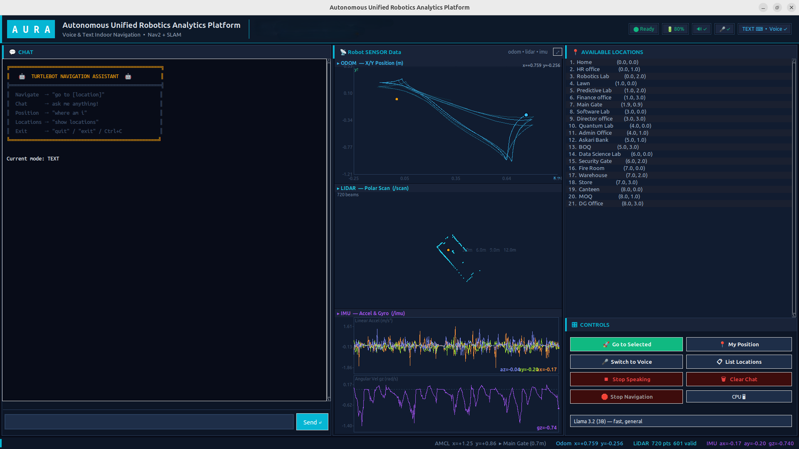
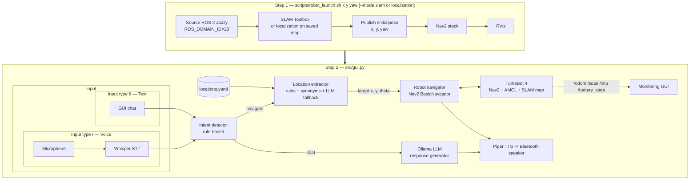
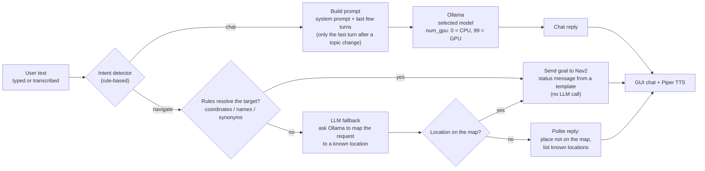
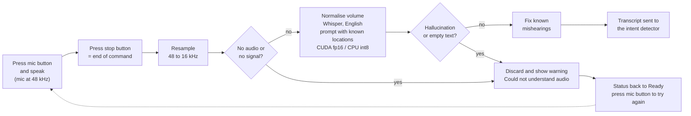
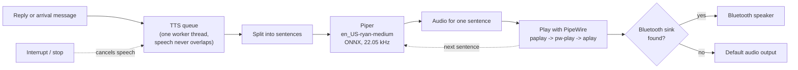
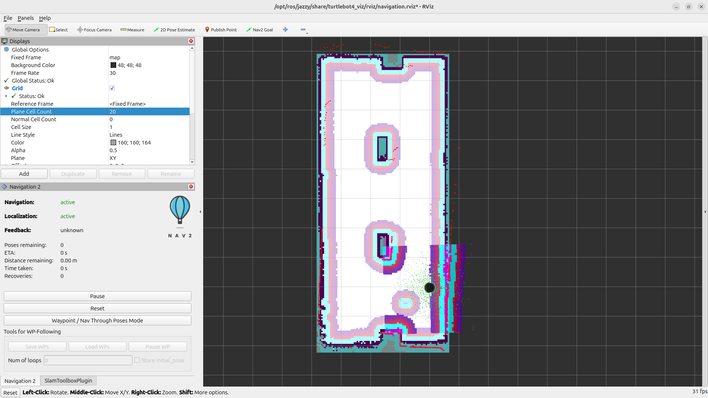

# Natural-Language Navigation for TurtleBot 4 

A voice- and text-controlled navigation assistant for a **TurtleBot 4** running **ROS 2 Jazzy**, **SLAM Toolbox**
and **Nav2**. You tell the robot where to go in plain language ("take me to the robotics lab"),
a local LLM handles conversation and ambiguous requests, and Nav2 drives the robot there.

Everything runs **locally** – speech recognition, LLM inference and text-to-speech need no cloud services.

<p align="center"> <br><br>  </p>

## Features

- **Natural-language navigation** – named locations, synonyms ("HR", "human resources"), raw coordinates, and
  multi-stop requests (`go to home then lawn`) queued and executed in order.
- **Hybrid intent + location understanding** – fast rule-based intent detection (navigate vs. chat) and
  fuzzy location matching with a strict token-coverage guard to avoid sending the robot to the wrong location;
  a local LLM (Ollama) is used as a fallback for requests the rules can't resolve.
- **Conversational LLM** – chat stays live *while the robot is navigating*; arrival is announced contextually.
- **Voice in / voice out** – Whisper (speech-to-text) with resampling for USB microphones, and Piper neural TTS routed to a Bluetooth speaker (auto-detected PipeWire sink).
- **Runtime CPU/GPU and model switching** – the GUI lets you pick the Ollama model and CPU vs. GPU inference on the fly.
- **One-command robot bring-up** – `scripts/robot_launch.sh` starts SLAM or localization, sets the robot's initial
  pose, and launches Nav2 and RViz.
- **Monitoring GUI (Tkinter)** – chat, location list, controls, and live robot sensor plots
  (odometry path, LiDAR polar plot, IMU, battery).

## Architecture

The system starts in **two steps**. First the robot stack is brought up with `scripts/robot_launch.sh`
(together with the robot's starting position). Then the assistant GUI (`src/gui.py`)
is started and talks to that running stack.



### How it works

1. **Input.** The user types in the GUI, or speaks. In the GUI, speech is push-to-talk: the user presses the mic
   button to start and presses it again to tell the system the command has ended. `sounddevice` records from the USB
   microphone at 48 kHz, the audio is resampled to 16 kHz with `scipy`, and Whisper transcribes it locally (CUDA fp16
   if a GPU is present, otherwise CPU int8).
2. **Intent detection** (`intent_detector.py`). Fast rule-based matching decides *navigate* vs *chat* from trigger
   phrases ("go to", "take me to", ...) and question prefixes ("what", "can you", ...). No LLM call is needed, so
   the decision is instant and deterministic.
3. **Chat path.** Chat messages go to a local LLM through Ollama (`response_generator.py`).
4. **Navigation path** (`location_extractor.py`). The target is resolved in this order:
   raw coordinates -> named location in `locations.yaml`-> LLM fallback.
   A token-coverage guard (at least 75 % of the meaningful words must match) rejects near-misses. Commands like "go to home then lawn" become an ordered queue, and goals are checked against the map bounds.
5. **Navigation** (`robot_navigator.py`). Each goal is sent to Nav2 as a `NavigateToPose` action through
   `BasicNavigator`, in the `map` frame. The pose comes from AMCL (`/amcl_pose`). A dedicated ROS executor thread
   keeps callbacks running without blocking the chat.
6. **Feedback.** Arrival events are queued and announced with Piper TTS on a Bluetooth speaker, and the GUI shows
   chat, locations, controls and live sensor plots (`/odom`, `/scan`, `/imu`, `/battery_state`).

**Threads** (`chat_interface.py`): chat loop, navigation worker, TTS worker (serialises speech), ROS executor, and
the GUI backend thread. Chatting and speaking stay responsive while the robot is driving.

**Design choices**

- **Rules first, LLM second.** Navigation commands are safety-relevant, so they use deterministic matching. The LLM
  is used for conversation and as a fallback for requests the rules cannot resolve.
- **Fully local.** Speech recognition, LLM and TTS run on the user's own machine. There are no API keys and no
  audio leaves the machine.
- **Non-blocking.** Navigation, speech and chat run in separate threads.

## Step 1 — Robot bring-up (`scripts/robot_launch.sh`)

One script starts everything the assistant needs on the robot side. Run it in its own terminal and keep it open.

```bash
./scripts/robot_launch.sh <x> <y> <yaw_deg> 
```

| Argument | Meaning |
|---|---|
| `<x> <y>` | Robot's current position on the map, in metres |
| `<yaw_deg>` | Robot's heading in degrees: `0` = East, `90` = North, `180` = West, `270` = South |


Examples:

```bash
./scripts/robot_launch.sh 0 0 0                          # localize at the origin, facing East
./scripts/robot_launch.sh 1 1 90                         # localize at x=1, y=1, facing North
```

What it does, in order:

1. Checks that ROS 2 Jazzy is installed.
2. Sources ROS 2 and sets `ROS_DOMAIN_ID=23`. or any other ROS_ID
3. Launches `turtlebot4_navigation` **SLAM** or **localization** (AMCL on the saved map).
4. **Localization mode:** converts the yaw to a quaternion and publishes the starting pose on `/initialpose`
   (retried up to 5 times until AMCL is ready), so the robot is localized without clicking in RViz.
   The pose you pass must match where the robot is physically standing on the map.
5. Launches the **Nav2** navigation stack.
6. Launches **RViz** (`turtlebot4_viz`) for visualisation.

Each service logs to `/tmp/` (`slam.log`, `localization.log`, `nav2.log`, `rviz.log`). Press **Ctrl+C** once to stop
all services cleanly. In SLAM mode, save the finished map with
`ros2 service call /slam_toolbox/save_map slam_toolbox/srv/SaveMap "name: {data: 'maps/my_map'}"`
(more commands in [`docs/turtlebot4_commands.md`](docs/turtlebot4_commands.md)).

## AI components: LLM, speech-to-text, text-to-speech

No model weights are stored in this repository. Each is downloaded on install or first use.

### Language model (LLM) — Ollama

`src/response_generator.py` runs a local LLM through [Ollama](https://ollama.com). It is used for three things:
free-form conversation, polite replies when a requested place is not on the map (it lists the known locations),
and as the fallback in `location_extractor.py` for requests the rules cannot resolve.
Simple status messages ("Heading to the lab now!", "I've arrived at the lawn!") are templates and do not call the LLM,
which keeps navigation feedback instant. Each reply sees only the last few conversation turns (just the last one
after a topic change), which keeps prompts short and fast on small hardware.

The model and CPU/GPU mode can be switched at runtime from the GUI (`num_gpu` = 0 for CPU, 99 for full GPU offload).
Only models that are actually installed are offered.

**How the LLM component works**



| Model | Parameters | Download size* | Notes |
|---|---|---|---|
| `llama3.2:3b` (default) | 3 B | ~2.0 GB | fastest, good for chat and the fallback |
| `mistral:7b` | 7 B | ~4.1 GB | balanced speed and quality |
| `qwen2.5:7b` | 7 B | ~4.7 GB | strong on factual and multilingual input |
| `llama3.1:8b` | 8 B | ~4.9 GB | strongest general answers, slowest |

```bash
ollama pull llama3.2:3b      # pull any of the others the same way
```

### Speech-to-text (STT) — Whisper

`src/voice_input.py` transcribes speech locally using **faster-whisper** (CTranslate2), with `openai-whisper` as a fallback.

**GUI push-to-talk:** Press the mic button to start recording (red with a stop symbol), speak, then press again to stop. No silence detection is needed, so pauses or background noise won't cut commands short.

Audio is processed as follows:

1. Resampled from native 48 kHz to Whisper's required 16 kHz.
2. Checked for a valid audio signal and volume-normalised.
3. Transcribed in English using known locations from `locations.yaml` to improve recognition of names like "DG Office" and "BOQ".
4. Filtered for common hallucinations and corrected for known location-name mishearings.

**Performance:** Uses CUDA with FP16 when a GPU is available; otherwise, CPU with INT8.

**Error handling:** If audio is empty, has no signal, contains a hallucination, or produces no text, the GUI displays *"Could not understand audio"*, sends nothing to the assistant, and returns to *Ready* for a new recording.


**How the speech-to-text component works**



Choose the size when starting the GUI, for example `python3 gui.py --voice-model base` (default `large-v3`; `base` is a good CPU choice):

| Model | Parameters | Size* | Typical use |
|---|---|---|---|
| `base` | 74 M | ~145 MB | good on CPU |
| `small` | 244 M | ~465 MB | balanced |
| `large-v3` | 1.55 B | ~3.1 GB | most accurate, GPU recommended |

### Text-to-speech (TTS) — Piper

`src/voice_output.py` speaks with **Piper**, a fast local neural TTS engine, using the `en_US-ryan-medium` voice
(ONNX, 22.05 kHz, about 60 MB). Replies are synthesised sentence by sentence so speech starts quickly, and the
audio is played through PipeWire (`paplay`, then `pw-play`, then `aplay` as fallbacks) on an auto-detected
Bluetooth speaker, or the default output if none is connected. Speech can be interrupted at any time.
`scripts/install_piper.sh` installs Piper and downloads the voice. The app expects the voice files at
`~/piper_models/en_US-ryan-medium.onnx` and `.onnx.json`.

**How the text-to-speech component works**




## Main libraries

| Area | Library | Used for |
|---|---|---|
| Robotics | ROS 2 Jazzy (`rclpy`) | nodes, topics, actions |
| Navigation | Nav2 (`nav2_simple_commander`), AMCL | goal navigation and localization |
| Mapping | SLAM Toolbox | building and saving maps |
| Robot | TurtleBot 4 packages | bringup, navigation and viz launch files |
| LLM | `ollama` (Python client) | chat and location fallback |
| Speech-to-text |  `Whisper`, `torch` | local transcription, GPU detection |
| Audio | `sounddevice`, `scipy`, `numpy` | mic capture, 48 -> 16 kHz resampling |
| Text-to-speech | Piper, PipeWire (`paplay` / `pw-play`) | neural voice to Bluetooth speaker |
| Geometry | `transforms3d` | yaw <-> quaternion conversion |
| Config | `PyYAML` | named locations |
| UI | `tkinter` | monitoring GUI |

## Requirements
- Ubuntu 24.04, **ROS 2 Jazzy**, TurtleBot 4 packages (`turtlebot4_navigation`, `turtlebot4_viz`), Nav2, SLAM Toolbox
- [Ollama](https://ollama.com) with a local model (default `llama3.2:3b`)
- Python packages: `pip install -r requirements.txt`


## Repository layout

```
src/                     Application (run from this directory)
  gui.py                   GUI: chat + voice + locations + controls + sensor plots (main entry point)
  main.py                  Optional terminal entry point (see `python3 main.py --help`)
  chat_interface.py        Chat loop, threading, multi-stop queue
  intent_detector.py       navigate-vs-chat classification
  location_extractor.py    Named / coordinate / LLM-fallback target extraction
  location_manager.py      locations.yaml loader
  response_generator.py    Ollama inference + shared CPU/GPU/model config
  robot_navigator.py       Nav2 BasicNavigator wrapper + AMCL pose tracking
  voice_input.py           Whisper STT
  voice_output.py          Piper TTS -> PipeWire/Bluetooth
  locations.yaml           Named goals in map coordinates
maps/                    Saved occupancy maps (.pgm + .yaml): robotic_arena, map_1, indoor_map, gallery_map
scripts/
  robot_launch.sh          Step 1: SLAM/localization + initial pose + Nav2 + RViz
  setup.bash               ROS 2 environment for the assistant terminal
  install_voice.sh         Voice (STT) dependencies
  install_piper.sh         Piper TTS + voice model
eval/                    Evaluation kit that produced the Results section (see eval/README.md)
  nlu_test_cases.csv       53 test commands with expected answers
  eval_nlu.py              Language-understanding test (rules only / rules + LLM)
  record_samples.py        Records the spoken test set
  eval_stt.py              Speech-recognition test (word error rate, time)
  eval_llm.py              LLM comparison (accuracy, speed, memory)
  make_latency_csv.py      Collects latency measurements into one CSV
  auto_nav_trials.py       Automated robot trials (sends commands, drives, logs reached / time / bumps)
  navigation_trials_template.csv  Column layout of the robot-trial CSV
  summarize.py             Turns trial CSVs into README tables
  optional_rule_fix.patch  Optional patch for the rule-based matching
  stt_samples/             39 recorded WAV files + manifest.csv
  results/                 Raw results (CSV) behind every table below
Results/                 GUI screenshot and demo recordings (GIF / MP4)
docs/                    ROS 2 / Nav2 command cheat-sheet
requirements.txt         Python dependencies
LICENSE                  MIT
```


## Quick start

Use **two terminals**. Install once, then each session: robot first, assistant second.

```bash
# One-time setup
pip install -r requirements.txt
ollama pull llama3.2:3b
./scripts/install_voice.sh          # optional: voice input
./scripts/install_piper.sh          # optional: voice output
```

**Terminal 1 — start the robot stack with the robot's position**

```bash
./scripts/robot_launch.sh 0 0 0     # x y yaw_deg   
```

**Terminal 2 — start the assistant** (same ROS domain as terminal 1)

```bash
source scripts/setup.bash           # ROS 2 Jazzy, domain 23, Fast DDS profile
cd src                              # run from src/ so locations.yaml is found
python3 gui.py                      # GUI (chat + voice + sensor plots)
# python3 gui.py --voice-model base   # optional: smaller, faster Whisper model
```

Edit `src/locations.yaml` to define your own named goals .
More ROS 2 commands (SLAM, map saving, docking, reverse-motion override): [`docs/turtlebot4_commands.md`](docs/turtlebot4_commands.md).

## Results

**Test setup:** The language, speech and LLM tests (sections 1-4) were run offline on a PC, with no robot involved,
using the 21 named goals in `src/locations.yaml` (map `maps/robotic_arena.yaml`; TurtleBot 4, Ubuntu 24.04,
ROS 2 Jazzy). The navigation trials (section 5) were run on the real TurtleBot 4 with the same `locations.yaml`.

**PC specifications:**
- CPU: Intel Core i9-14900KF
- GPU: NVIDIA GeForce RTX 4070 Ti SUPER (16 GB)
- RAM: 62 GB

**Models:** LLM `llama3.2:3b` (plus `llama3.2:1b` and `llama3.1:8b` in the LLM comparison); Whisper `base`, `small` and `large-v3`.

**Raw results:** `eval/results/`

### 1. Language Understanding (text input)

Language understanding was tested using text input to separate language-understanding errors from speech-recognition errors. The dataset contains 45 navigation commands and 8 chat messages (53 total), from `eval/nlu_test_cases.csv`.

- **Rules only:** No LLM is used.
- **Rules + LLM:** `llama3.2:3b` handles targets that the rules cannot resolve.


| Command type | Example | No of Times | Rules only | Rules + LLM | Notes |
|---|---|---:|---:|---:|---|
| Named location | `go to robotics lab` | 13 | 13/13 | 13/13 | | -
| Named + filler words | `can you take me to the canteen please` | 6 | 0/6 | 5/6 | LLM fallback needed; `could you take me to the fire room` never reached the LLM |
| Synonym | `go to hr` | 7 | 0/7 | 3/7 | LLM resolved the one-word synonyms; synonyms inside a sentence (`take me to human resources`) failed |
| Coordinates | `go to (1.0, 2.0)` | 6 | 5/6 | 5/6 | `x 1.0 y 2.0` form not parsed |
| Multi-stop | `go to home then lawn` | 6 | 6/6 | 6/6 | | -
| Invalid / unknown place | `go to the moon` | 7 | Rejected 7/7 | Rejected 7/7 | No goal sent |
| Chat (not navigation) | `what is your name` | 8 | 8/8 | 8/8 | Correctly classified as chat |
| **All commands** | | **53** | **39/53 (74%)** | **47/53 (89%)** | |

### 2. Speech Recognition

**Test conditions:** 39 spoken commands per model, quiet room, GPU acceleration.

| Whisper Model | Word Error Rate | Command Understood | Transcription Time (s) |
|---|---:|---:|---:|
| `base` | 16.0% | 20/39 | 0.03 |
| `small` | 13.9% | 21/39 | 0.07 |
| `large-v3` | 10.2% | 23/39 | 0.17 |

Word error rate (WER) is the proportion of reference words that were incorrectly transcribed. A command is considered understood if the transcript resolves to the correct target or an invalid location is correctly rejected. Transcription time is the mean per clip, excluding warm-up. The LLM fallback was not used in this test, so the figures are comparable to the "Rules only" column of the text test.

#### Observations

- Plain named-location commands performed well across all models, with 11–12 of 13 commands understood and WER between 2% and 6%.
- All invalid locations were correctly rejected (7/7).
- Filler-word commands failed on all models (0/6), while synonyms were understood in only 1/7 cases per model.
- The transcripts for filler-word commands were nearly perfect. For `large-v3`, the filler-word WER was 2.5%.

### 3. End-to-End Latency (CPU vs. GPU)

| Stage | CPU | GPU |
|---|---:|---:|
| Speech to text (`large-v3`, mean of 39 clips) | 4.05 s (std 0.12) | 0.17 s (std 0.02) |
| Intent and location extraction (rules, median of 45) | 0.016 ms | 0.016 ms |
| LLM fallback (median of 7 warm calls) | 0.38 s | 0.10 s |
| LLM first call after startup (model loading included) | 17.95 s | 24.41 s |


#### Latency Notes

The rule-based processing path takes approximately 0.016 ms, making it effectively instantaneous. Therefore, LLM latency affects only commands that require fallback processing.
The first LLM call after application startup or switching between CPU and GPU takes approximately 18–24 seconds because the model must be loaded. These calls are excluded from the warm-call averages.


### 4. LLM Comparison

All three models were evaluated using:
- 8 fallback location commands that the rules could not resolve and that passed the LLM guard.
- 10 short chat questions using the same prompt template as the application.

Times exclude the initial model-loading call. Fallback time is the mean of the 8 commands; the latency table above gives the median of warm calls, so the CPU values differ.

**Source:** `eval/results/llm_comparison.csv`

| Model | Device | Fallback Location Accuracy | Fallback Time (s) | Chat Reply Time (s) | Tokens/s | Model Memory | GPU Memory in Use |
|---|---|---:|---:|---:|---:|---|---:|
| `llama3.2:1b` | CPU | 7/8 | 0.39 | 1.55 ± 0.14 | 44.8 | 1.4 GB RAM | N/A |
| `llama3.2:1b` | GPU | 5/8 | 0.09 | 0.25 ± 0.02 | 398.2 | 1.7 GB | 2.5 GB |
| `llama3.2:3b` | CPU | 8/8 | 0.69 | 2.55 ± 0.20 | 28.3 | 2.5 GB RAM | N/A |
| `llama3.2:3b` | GPU | 8/8 | 0.10 | 0.69 ± 1.06 | 249.5 | 2.8 GB | 3.5 GB |
| `llama3.1:8b` | CPU | 8/8 | 1.03 | 5.28 ± 0.53 | 12.8 | 5.2 GB RAM | N/A |
| `llama3.1:8b` | GPU | 8/8 | 0.09 | 0.64 ± 0.04 | 119.5 | 5.5 GB | 6.0 GB |

GPU memory usage includes approximately 0.55 GB used by other processes. The high standard deviation in the `llama3.2:3b` GPU chat time indicates one unusually slow call among the 10 questions.

The smallest model, `llama3.2:1b`, is the fastest but the least reliable. Its misses were wrong-location answers, not
refusals: `take me to the robotics lab` -> *Quantum Lab* and `go to admin` -> *MOQ* (GPU run), `go to hr` -> *MOQ*
(CPU run), plus one `NONE` for `can you take me to the canteen please` (GPU run). The same model scored 7/8 on CPU and
5/8 on GPU in single runs, so its accuracy is also unstable between runs. `llama3.2:1b` was evaluated with
`eval/eval_llm.py` only; it is not in the GUI model list (`response_generator.py`).

### 5. Robot Navigation Trials

The full pipeline was tested on the TurtleBot 4 with typed commands: intent detection, location extraction and Nav2.
Each of two routes was run 5 times from the same start location, and the robot was sent back to the start between
runs (through Nav2, not timed). Three unknown places were also tried; the assistant must refuse them and the robot must
stay still. The runs were automated with `eval/auto_nav_trials.py`.

**Source:** `eval/results/navigation_trials.csv`

| Route / goal | Trials | Goal reached | Travel time (s, mean ± SD) | Collisions |
|---|---:|---:|---:|---:|
| Lawn -> Main Gate (`go to Main Gate`) | 5 | 5/5 | 8.1 ± 0.2 | 0 |
| Main Gate -> Lawn (`go to Lawn`) | 5 | 5/5 | 12.8 ± 0.6 | 0 |
| Unknown place (`go to the moon`, `go to mars`, `take me to narnia`) | 3 | Refused 3/3 | n/a | n/a |

**How it was measured**

- **Reached:** Nav2 reported success and the AMCL pose was within 0.35 m of the goal. This is the robot's own
  localization estimate, not an external measurement.
- **Travel time:** from sending the goal to arrival. Speech recognition, language understanding and the Nav2 readiness
  check are not included.
- **Collisions:** bumper hits counted from `/hazard_detection`. Scrapes and near-misses are not counted.

**Observations**

- All 10 navigation trials succeeded with no collisions, and all 3 unknown places were refused without any motion.
- The return direction took longer (12.8 s vs 8.1 s) on the same route. The untimed reset legs show the same
  difference, so it looks systematic and not random. The cause was not investigated.
- The sample is small: 5 runs per route, two short routes (about 1.3 m), one start pose and typed commands. With
  10 successes out of 10 the 95 % confidence interval (Clopper-Pearson) for the success rate has a lower bound of about
  69 %, so the test shows that the pipeline works but does not give a precise reliability figure.

**Reproduce**

```bash
# robot stack running (scripts/robot_launch.sh), robot standing on the first start location
python3 eval/auto_nav_trials.py --routes "Lawn>Main Gate" "Main Gate>Lawn" --runs 5 --init-pose 1.0 0.0 1.57
python3 eval/summarize.py nav eval/results/navigation_trials.csv
```

`--init-pose X Y YAW` publishes the initial pose for you; the yaw is in **radians** here (`robot_launch.sh` takes degrees).
Use `--dry-run` to check how each command is understood without moving the robot. See `eval/README.md` for all options.

### 6. Observed Failure Cases

#### 6.1 Filler Words and Synonyms

The rule-based system failed to resolve all 6 filler-word commands and all 7 synonym commands.

Examples include:
- `could you take me to the fire room`
- `take me to human resources`
- `go to hr`
- `go to admin`

The LLM fallback resolved 8 of these 13 cases.

#### 6.2 Commands Not Passed to the LLM

Six cases failed even with the LLM available because the rule-based guard did not pass them to the fallback:

- `could you take me to the fire room`
- `take me to human resources`
- `go to HR department`
- `go to director general office`
- `go to b o q`
- `go to x 1.0 y 2.0`

These failures indicate that command normalization (polite prefixes such as `could you`, synonyms inside a sentence, coordinate formats) and the fallback guard need to be improved so that these commands are resolved.

#### 6.3 Multi-Stop Voice Commands

Multi-stop commands achieved 6/6 successful resolutions using text input. For spoken commands, the success rate was:
- `base`: 1/6
- `small`: 1/6
- `large-v3`: 4/6

Most spoken failures came from the connector word or the second location being mis-transcribed: for example `and then canteen` became `and then continue`, `then canteen` became `then then continue`, and with `base` `then go to warehouse` was sometimes transcribed as `and go to warehouse`.

#### 6.4 Short or Low-Energy Audio Clips

Speech recognition occasionally generated hallucinated text, such as `Thank you`, from short or low-energy recordings. This motivated the silence and hallucination checks implemented in `voice_input.py`.

### 7. Key Takeaways

- **Language understanding:** Adding the LLM fallback increased text understanding from 74% (39/53) to 89% (47/53).
- **Fallback latency:** The LLM adds approximately 0.4 seconds per fallback call on CPU (about 0.1 seconds on GPU) in the full language-understanding test.
- **Invalid locations:** The system correctly rejected all 7 invalid-location commands in the text test.
- **Speech recognition:** Whisper `large-v3` on GPU achieved the lowest WER (10.2%) and an average transcription time of approximately 0.17 seconds.
- **LLM selection:** `llama3.2:3b` and `llama3.1:8b` both resolved all 8 fallback commands, so the larger model showed no accuracy improvement. The smaller `llama3.2:1b` was the fastest (0.25 s GPU chat reply) but resolved only 7/8 (CPU) and 5/8 (GPU), mostly by naming the wrong place.
- **Resource efficiency:** `llama3.2:3b` requires less memory and provides faster CPU chat responses than the 8B model while keeping full accuracy, making it the recommended default.
- **Robot navigation:** On the real robot, 10 of 10 navigation trials reached the goal with no bumper collisions, and all 3 unknown places were refused without moving.
- **Limitations:** The sample sizes are small (6–13 commands per category in the text tests, 5 runs per route on the robot), so differences of one command should not be overinterpreted.

Overall, the results indicate that the main limitation is the rule-based language-understanding and fallback-guard logic, rather than speech recognition alone. Once a command is resolved, the navigation side worked reliably in the trials. Improving command normalization, synonym handling, coordinate parsing, and multi-stop connector processing should further improve system performance.

## Demo From One Location to Another Location
**GUI + RViz Visualization**
<p align="center"> </p>


**Real Time Navigation**

<p align="center"> </p>

<br>

**GUI + RViz Visualization**

<!-- <p align="center"> 
</p> -->

## Known limitations
- Locations and the 8 x 3 m map bounds are specific to the original lab setup (`src/locations.yaml`, `MAP_BOUNDS` in `location_extractor.py`).
- Code was developed against specific audio hardware (USB mic at 48 kHz, PipeWire Bluetooth sink).
- Single-robot only.
- The robot navigation trials are small (2 routes x 5 runs, typed commands, one environment); "reached" is judged from the AMCL pose and collisions are bumper hits only. Spoken commands were not tested on the robot.
- In our setup the initial pose published by `robot_launch.sh` was not always picked up by AMCL. If the robot is not localized, set the pose with **2D Pose Estimate** in RViz (or use `--init-pose` for the evaluation script).


## License

MIT – see [LICENSE](LICENSE).
