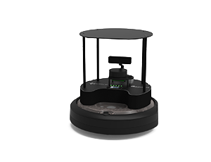
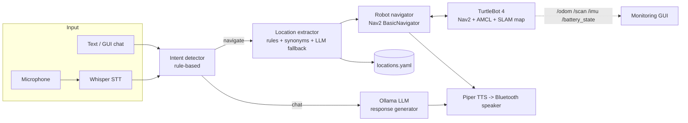

<!-- <p align="center">
  
</p> -->

# Natural-Language Navigation for TurtleBot 4

A voice- and text-controlled navigation assistant for a **TurtleBot 4** running **ROS 2 Jazzy**, **SLAM Toolbox**
and **Nav2**. You tell the robot where to go in plain language ("take me to the robotics lab, then the lawn"),
a local LLM handles conversation and ambiguous requests, and Nav2 drives the robot there.

Everything runs **locally** – speech recognition, LLM inference and text-to-speech need no cloud services.

> **Demo:** _add a GIF / video link here (see "Adding a demo" below)_

---

## Features

- **Natural-language navigation** – named locations, synonyms ("HR", "human resources"), raw coordinates, and
  multi-stop requests (`go to home then lawn`) queued and executed in order.
- **Hybrid intent + location understanding** – fast rule-based intent detection (navigate vs. chat) and
  fuzzy location matching with a strict token-coverage guard to avoid sending the robot to the wrong room;
  a local LLM (Ollama) is used as a fallback for requests the rules can't resolve.
- **Conversational LLM** – chat stays live *while the robot is navigating*; arrival is announced contextually.
- **Voice in / voice out** – Whisper / faster-whisper speech-to-text with resampling for USB microphones,
  and Piper neural TTS routed to a Bluetooth speaker (auto-detected PipeWire sink).
- **Runtime CPU/GPU and model switching** – the GUI lets you pick the Ollama model and CPU vs. GPU inference on the fly.
- **SLAM + Nav2 workflow** – map an area with SLAM Toolbox, save the map, localize with AMCL and navigate to named goals.
- **Monitoring GUI (Tkinter)** – chat, location list, controls, and live robot sensor plots
  (odometry path, LiDAR polar plot, IMU, battery).

## Architecture


<!-- ### How it works -->

1. **Input.** The user types in the terminal or GUI, or speaks. For speech, `sounddevice` records from the USB
   microphone at 48 kHz, voice-activity thresholds (4 sensitivity levels) detect when the user stops talking, the
   audio is resampled to 16 kHz with `scipy`, and Whisper transcribes it locally (CUDA fp16 if a GPU is present,
   otherwise CPU int8).
2. **Intent detection** (`intent_detector.py`). Fast rule-based matching decides *navigate* vs *chat* from trigger
   phrases ("go to", "take me to", ...) and question prefixes ("what", "can you", ...). No LLM call is needed, so
   the decision is instant and deterministic.
3. **Chat path.** Chat messages go to a local LLM through Ollama (`response_generator.py`).
4. **Navigation path** (`location_extractor.py`). The target is resolved in this order:
   raw coordinates -> named location in `locations.yaml` (with synonyms and fuzzy matching) -> LLM fallback.
   A token-coverage guard (at least 75 % of the meaningful words must match) rejects near-misses such as
   "dg office" vs "dg wd office", so the robot is not sent to the wrong room. Requests such as
   "go to home then lawn" become an ordered queue, and goals are checked against the map bounds.
5. **Navigation** (`robot_navigator.py`). Each goal is sent to Nav2 as a `NavigateToPose` action through
   `BasicNavigator`, in the `map` frame. The pose comes from AMCL (`/amcl_pose`). A dedicated ROS executor thread
   keeps callbacks running without blocking the chat.
6. **Feedback.** Arrival events are queued and announced with Piper TTS on a Bluetooth speaker, and the GUI shows
   chat, locations, controls and live sensor plots (`/odom`, `/scan`, `/imu`, `/battery_state`).

**Threads** (`chat_interface.py`): chat loop, navigation worker, TTS worker (serialises speech), ROS executor, and
the GUI backend thread. Chatting and speaking stay responsive while the robot is driving.

**Design choices**

- **Rules first, LLM second.** Navigation commands are safety-relevant, so they use deterministic matching. The LLM
  is used for conversation and as a fallback for requests the rules cannot resolve.
- **Fully local.** Speech recognition, LLM and TTS run on the user's own machine. There are no API keys and no
  audio leaves the machine.
- **Non-blocking.** Navigation, speech and chat run in separate threads.

## Main libraries

| Area | Library | Used for |
|---|---|---|
| Robotics | ROS 2 Jazzy (`rclpy`) | nodes, topics, actions |
| Navigation | Nav2 (`nav2_simple_commander`), AMCL | goal navigation and localization |
| Mapping | SLAM Toolbox | building and saving maps |
| Robot | TurtleBot 4 packages | bringup, navigation and viz launch files |
| LLM | `ollama` (Python client) | chat and location fallback |
| Speech-to-text | `faster-whisper`, `openai-whisper`, `torch` | local transcription, GPU detection |
| Audio | `sounddevice`, `scipy`, `numpy` | mic capture, 48 -> 16 kHz resampling |
| Text-to-speech | Piper, PipeWire (`paplay` / `pw-play`) | neural voice to Bluetooth speaker |
| Geometry | `transforms3d` | yaw <-> quaternion conversion |
| Config | `PyYAML` | named locations |
| UI | `tkinter` | monitoring GUI |

## Models

No model weights are stored in this repository. Each is downloaded on install or first use.

**Language model (Ollama, selectable at runtime in the GUI; default `llama3.2:3b`)**

| Model | Parameters | Download size* | Notes |
|---|---|---|---|
| `llama3.2:3b` (default) | 3 B | ~2.0 GB | fastest, good for chat and the fallback |
| `mistral:7b` | 7 B | ~4.1 GB | balanced speed and quality |
| `qwen2.5:7b` | 7 B | ~4.7 GB | strong on factual and multilingual input |
| `llama3.1:8b` | 8 B | ~4.9 GB | strongest general answers, slowest |

**Speech-to-text (Whisper, set with `--voice-model`; code default `large-v3`)**

| Model | Parameters | Size* |
|---|---|---|
| `tiny` | 39 M | ~75 MB |
| `base` | 74 M | ~145 MB |
| `small` | 244 M | ~465 MB |
| `medium` | 769 M | ~1.5 GB |
| `large-v3` | 1.55 B | ~3.1 GB |

**Text-to-speech:** Piper `en_US-ryan-medium` (ONNX, 22.05 kHz), about 60 MB.

\*Approximate. Larger models are more accurate but need more disk, RAM or VRAM and add latency.
Check your own with `ollama list`.

## Repository layout

```
src/                     Application (run from this directory)
  main.py                  Terminal entry point (voice or text)
  gui.py                   GUI: chat + locations + controls + sensor plots
  chat_interface.py        Chat loop, threading, multi-stop queue
  intent_detector.py       navigate-vs-chat classification
  location_extractor.py    Named / coordinate / LLM-fallback target extraction
  location_manager.py      locations.yaml loader
  response_generator.py    Ollama inference + shared CPU/GPU/model config
  robot_navigator.py       Nav2 BasicNavigator wrapper + AMCL pose tracking
  voice_input.py           Whisper STT
  voice_output.py          Piper TTS -> PipeWire/Bluetooth
  locations.yaml           Named goals in map coordinates
maps/                    Saved occupancy maps (SLAM output)
scripts/                 Robot launch (SLAM / localization) + voice/TTS install scripts
docs/                    ROS 2 / Nav2 command cheat-sheet
```

## Requirements

- Ubuntu 24.04, **ROS 2 Jazzy**, TurtleBot 4 packages (`turtlebot4_navigation`, `turtlebot4_viz`), Nav2, SLAM Toolbox
- [Ollama](https://ollama.com) with a local model (default `llama3.2:3b`)
- Python packages: `pip install -r requirements.txt`

## Quick start

```bash
# 1. Environment
source scripts/setup.bash                 # ROS 2 Jazzy, domain 23, Fast DDS profile
pip install -r requirements.txt
ollama pull llama3.2:3b

# 2. (Optional) voice
./scripts/install_voice.sh
./scripts/install_piper.sh
# The app expects the Piper voice at ~/piper_models/en_US-ryan-medium.onnx (+ .onnx.json)

# 3. Bring up localization on a saved map (or --mode slam to map a new area)
./scripts/robot_launch.sh 0 0 0           # initial pose: x y yaw_deg

# 4. Run the assistant (from src/, so locations.yaml is found)
cd src
python3 main.py --text-only               # text chat + navigation
python3 main.py --voice-model base --sensitivity medium   # voice mode
python3 gui.py                            # GUI
```

Edit `src/locations.yaml` to define your own named goals (`x`, `y`, `theta` in map frame).
More ROS 2 commands (SLAM, map saving, docking, reverse-motion override): [`docs/turtlebot4_commands.md`](docs/turtlebot4_commands.md).

## Results

> Replace every `__` with a number you measured. Report N and the test conditions. Small honest samples are better
> than large unverified claims.

**Test setup:** TurtleBot 4, Ubuntu 24.04, ROS 2 Jazzy, map `maps/robotic_arena.yaml`, __ named goals,
PC: __ CPU / __ GPU / __ GB RAM, LLM `llama3.2:3b`, Whisper `__`.

**1. Navigation success** (N = __ commands, __ goals, __ runs each)

| Command type | Example | Understood correctly | Reached goal | Notes |
|---|---|---|---|---|
| Named location | "go to the lawn" | __ / __ | __ / __ | |
| Synonym | "take me to human resources" | __ / __ | __ / __ | |
| Coordinates | "go to x 1.0 y 2.0" | __ / __ | __ / __ | |
| Multi-stop | "go to home then lawn" | __ / __ | __ / __ | |
| Invalid / unknown place | "go to the moon" | correctly rejected __ / __ | n/a | |

**2. Speech recognition** (N = __ spoken commands per model, quiet room)

| Whisper model | Word error rate | Command understood | Transcription time (s) |
|---|---|---|---|
| `base` | __ % | __ / __ | __ |
| `small` | __ % | __ / __ | __ |
| `large-v3` | __ % | __ / __ | __ |

**3. End-to-end latency** (mean of __ runs; CPU vs GPU)

| Stage | CPU | GPU |
|---|---|---|
| Speech -> text | __ s | __ s |
| Intent + location extraction (rules) | __ ms | __ ms |
| LLM fallback (when used) | __ s | __ s |
| Goal accepted by Nav2 | __ s | __ s |
| **Utterance -> robot starts moving** | **__ s** | **__ s** |

**4. LLM comparison** (same __ prompts, GPU/CPU: __)

| Model | Fallback location accuracy | Mean response time | Peak RAM / VRAM |
|---|---|---|---|
| `llama3.2:3b` | __ % | __ s | __ GB |
| `llama3.1:8b` | __ % | __ s | __ GB |

**Observed failure cases:** (e.g. misheard words in noise, goals the planner could not reach, ambiguous names) __

**Takeaways:** (one or two sentences: which model and settings you recommend and why) __

## Adding a demo

Record a 30–60 s clip (voice command -> robot moving -> arrival announcement, with the GUI visible),
export a short GIF to `docs/images/demo.gif`, and embed it near the top of this README with
``.

## Known limitations

- Locations and the 8 x 3 m map bounds are specific to the original lab setup (`src/locations.yaml`, `MAP_BOUNDS` in `location_extractor.py`).
- Code was developed against specific audio hardware (USB mic at 48 kHz, PipeWire Bluetooth sink).
- Single-robot only; no automated tests yet.

## License

MIT – see [LICENSE](LICENSE).