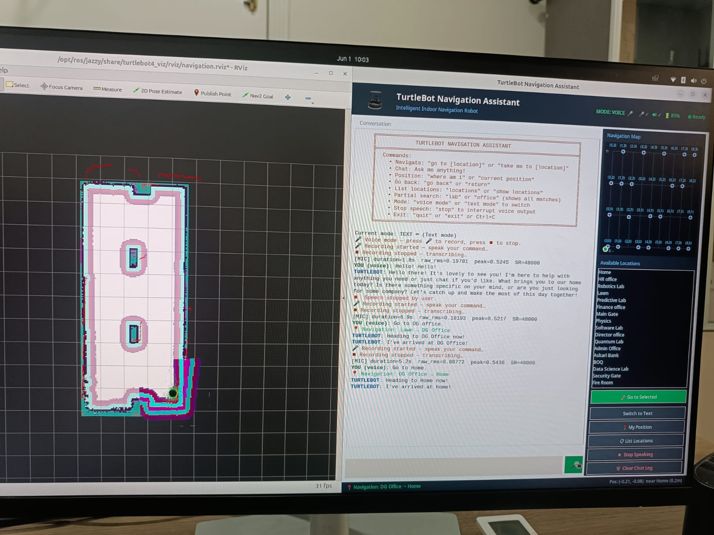
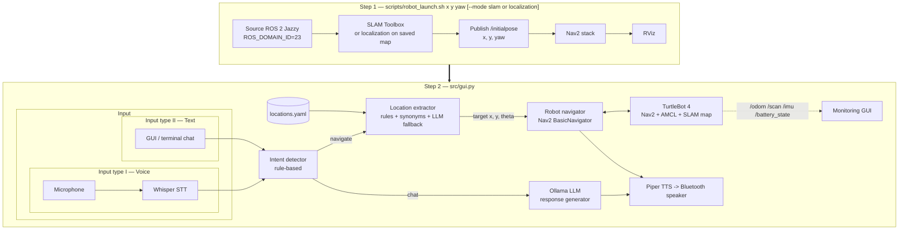
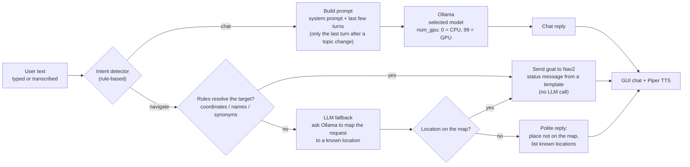
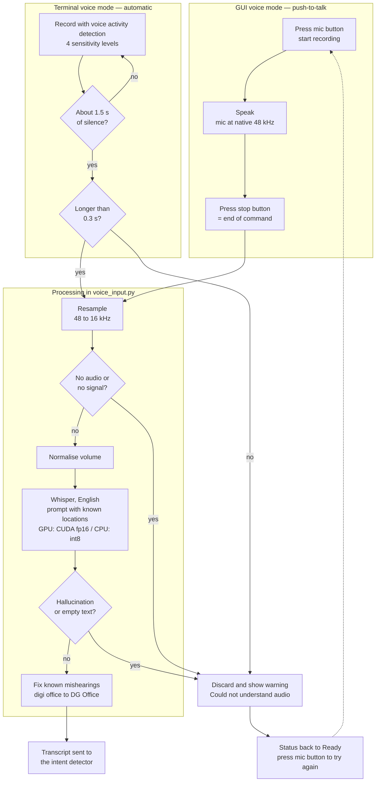
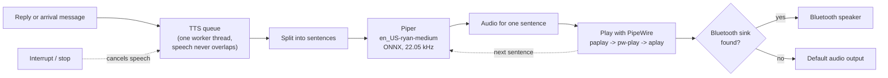

# Natural-Language Navigation for TurtleBot 4 

A voice- and text-controlled navigation assistant for a **TurtleBot 4** running **ROS 2 Jazzy**, **SLAM Toolbox**
and **Nav2**. You tell the robot where to go in plain language ("take me to the robotics lab, then the lawn"),
a local LLM handles conversation and ambiguous requests, and Nav2 drives the robot there.

Everything runs **locally** – speech recognition, LLM inference and text-to-speech need no cloud services.

<p align="center"> <br><br>  </p>

## Features

- **Natural-language navigation** – named locations, synonyms ("HR", "human resources"), raw coordinates, and
  multi-stop requests (`go to home then lawn`) queued and executed in order.
- **Hybrid intent + location understanding** – fast rule-based intent detection (navigate vs. chat) and
  fuzzy location matching with a strict token-coverage guard to avoid sending the robot to the wrong room;
  a local LLM (Ollama) is used as a fallback for requests the rules can't resolve.
- **Conversational LLM** – chat stays live *while the robot is navigating*; arrival is announced contextually.
- **Voice in / voice out** – Whisper / faster-whisper speech-to-text with resampling for USB microphones,
  and Piper neural TTS routed to a Bluetooth speaker (auto-detected PipeWire sink).
- **Runtime CPU/GPU and model switching** – the GUI lets you pick the Ollama model and CPU vs. GPU inference on the fly.
- **One-command robot bring-up** – `scripts/robot_launch.sh` starts SLAM or localization, sets the robot's initial
  pose, and launches Nav2 and RViz.
- **Monitoring GUI (Tkinter)** – chat, location list, controls, and live robot sensor plots
  (odometry path, LiDAR polar plot, IMU, battery).

## Architecture

The system starts in **two steps**. First the robot stack is brought up with `scripts/robot_launch.sh`
(together with the robot's starting position). Then the assistant (`src/gui.py` for the terminal)
is started and talks to that running stack.



### How it works

1. **Input.** The user types in the GUI, or speaks. In the GUI, speech is push-to-talk: the user presses the mic
   button to start and presses it again to tell the system the command has ended. `sounddevice` records from the USB
   microphone at 48 kHz, the audio is resampled to 16 kHz with `scipy`, and Whisper transcribes it locally (CUDA fp16
   if a GPU is present, otherwise CPU int8). Terminal voice mode has no button, so it uses voice-activity detection
   to end the recording instead.
2. **Intent detection** (`intent_detector.py`). Fast rule-based matching decides *navigate* vs *chat* from trigger
   phrases ("go to", "take me to", ...) and question prefixes ("what", "can you", ...). No LLM call is needed, so
   the decision is instant and deterministic.
3. **Chat path.** Chat messages go to a local LLM through Ollama (`response_generator.py`).
4. **Navigation path** (`location_extractor.py`). The target is resolved in this order:
   raw coordinates -> named location in `locations.yaml` (with synonyms and fuzzy matching) -> LLM fallback.
   A token-coverage guard (at least 75 % of the meaningful words must match) rejects near-misses. Commands like "go to home then lawn" become an ordered queue, and goals are checked against the map bounds.
5. **Navigation** (`robot_navigator.py`). Each goal is sent to Nav2 as a `NavigateToPose` action through
   `BasicNavigator`, in the `map` frame. The pose comes from AMCL (`/amcl_pose`). A dedicated ROS executor thread
   keeps callbacks running without blocking the chat.
6. **Feedback.** Arrival events are queued and announced with Piper TTS on a Bluetooth speaker, and the GUI shows
   chat, locations, controls and live sensor plots (`/odom`, `/scan`, `/imu`, `/battery_state`).

**Threads** (`chat_interface.py`): chat loop, navigation worker, TTS worker (serialises speech), ROS executor, and
the GUI backend thread. Chatting and speaking stay responsive while the robot is driving.

**Design choices**

- **Rules first, LLM second.** Navigation commands are safety-relevant, so they use deterministic matching. The LLM
  is used for conversation and as a fallback for requests the rules cannot resolve.
- **Fully local.** Speech recognition, LLM and TTS run on the user's own machine. There are no API keys and no
  audio leaves the machine.
- **Non-blocking.** Navigation, speech and chat run in separate threads.

## Step 1 — Robot bring-up (`scripts/robot_launch.sh`)

One script starts everything the assistant needs on the robot side. Run it in its own terminal and keep it open.

```bash
./scripts/robot_launch.sh <x> <y> <yaw_deg> 
```

| Argument | Meaning |
|---|---|
| `<x> <y>` | Robot's current position on the map, in metres |
| `<yaw_deg>` | Robot's heading in degrees: `0` = East, `90` = North, `180` = West, `270` = South |


Examples:

```bash
./scripts/robot_launch.sh 0 0 0                          # localize at the origin, facing East
./scripts/robot_launch.sh 1 1 90                         # localize at x=1, y=1, facing North
```

What it does, in order:

1. Checks that ROS 2 Jazzy is installed.
2. Sources ROS 2 and sets `ROS_DOMAIN_ID=23`. or any other ROS_ID
3. Launches `turtlebot4_navigation` **SLAM** or **localization** (AMCL on the saved map).
4. **Localization mode:** converts the yaw to a quaternion and publishes the starting pose on `/initialpose`
   (retried up to 5 times until AMCL is ready), so the robot is localized without clicking in RViz.
   The pose you pass must match where the robot is physically standing on the map.
5. Launches the **Nav2** navigation stack.
6. Launches **RViz** (`turtlebot4_viz`) for visualisation.

Each service logs to `/tmp/` (`slam.log`, `localization.log`, `nav2.log`, `rviz.log`). Press **Ctrl+C** once to stop
all services cleanly. In SLAM mode, save the finished map with
`ros2 service call /slam_toolbox/save_map slam_toolbox/srv/SaveMap "name: {data: 'maps/my_map'}"`
(more commands in [`docs/turtlebot4_commands.md`](docs/turtlebot4_commands.md)).

## AI components: LLM, speech-to-text, text-to-speech

No model weights are stored in this repository. Each is downloaded on install or first use.

### Language model (LLM) — Ollama

`src/response_generator.py` runs a local LLM through [Ollama](https://ollama.com). It is used for three things:
free-form conversation, polite replies when a requested place is not on the map (it lists the known locations),
and as the fallback in `location_extractor.py` for requests the rules cannot resolve.
Simple status messages ("Heading to the lab now!", "I've arrived at the lawn!") are templates and do not call the LLM,
which keeps navigation feedback instant. Each reply sees only the last few conversation turns (just the last one
after a topic change), which keeps prompts short and fast on small hardware.

The model and CPU/GPU mode can be switched at runtime from the GUI (`num_gpu` = 0 for CPU, 99 for full GPU offload).
Only models that are actually installed are offered.

**How the LLM component works**



| Model | Parameters | Download size* | Notes |
|---|---|---|---|
| `llama3.2:3b` (default) | 3 B | ~2.0 GB | fastest, good for chat and the fallback |
| `mistral:7b` | 7 B | ~4.1 GB | balanced speed and quality |
| `qwen2.5:7b` | 7 B | ~4.7 GB | strong on factual and multilingual input |
| `llama3.1:8b` | 8 B | ~4.9 GB | strongest general answers, slowest |

```bash
ollama pull llama3.2:3b      # pull any of the others the same way
```

### Speech-to-text (STT) — Whisper

`src/voice_input.py` transcribes speech locally with **faster-whisper** (OpenAI Whisper weights, CTranslate2 runtime;
`openai-whisper` is the fallback).

**In the GUI, speech is push-to-talk.** Press the mic button to start recording (it turns red and shows a stop
symbol), speak, then press it again. That second press is the command that the speech has ended, so no silence
detection is needed and pauses or background noise cannot cut the command short. The recording (at the microphone's
native 48 kHz) is then processed:

1. resampled to 16 kHz, the rate Whisper expects (this fixed garbled transcriptions);
2. rejected if there is no signal at all (unplugged or dead microphone);
3. volume-normalised, so quiet microphones still reach Whisper at a usable level;
4. transcribed by Whisper in English, with a prompt that lists the known location names from `locations.yaml`, so
   abbreviations such as "DG Office" or "BOQ" are preferred over similar-sounding English words;
5. checked against known Whisper hallucinations on silence or noise ("thanks for watching", "please subscribe", ...);
6. corrected for known mishearings of location names (for example "digi office" becomes "DG Office").

It runs on CUDA in fp16 when a GPU is available, otherwise on CPU in int8.

**If the recording is discarded** (no audio, no signal, a hallucination, or empty text), the GUI shows a warning
("Could not understand audio"), nothing is sent to the assistant, and the status returns to *Ready*. Press the mic
button again to record a new command.

**Terminal voice mode** (`main.py`) has no button, so it uses automatic voice-activity detection instead: four
sensitivity levels (`--sensitivity`), recording stops after about 1.5 s of silence, and recordings shorter than
0.3 s are discarded.

**How the speech-to-text component works**



Choose the size with `--voice-model` (code default `large-v3`; `base` is a good CPU choice):

| Model | Parameters | Size* | Typical use |
|---|---|---|---|
| `tiny` | 39 M | ~75 MB | very fast, lowest accuracy |
| `base` | 74 M | ~145 MB | good on CPU |
| `small` | 244 M | ~465 MB | balanced |
| `medium` | 769 M | ~1.5 GB | accurate, needs a good CPU/GPU |
| `large-v3` | 1.55 B | ~3.1 GB | most accurate, GPU recommended |

### Text-to-speech (TTS) — Piper

`src/voice_output.py` speaks with **Piper**, a fast local neural TTS engine, using the `en_US-ryan-medium` voice
(ONNX, 22.05 kHz, about 60 MB). Replies are synthesised sentence by sentence so speech starts quickly, and the
audio is played through PipeWire (`paplay`, then `pw-play`, then `aplay` as fallbacks) on an auto-detected
Bluetooth speaker, or the default output if none is connected. Speech can be interrupted at any time.
`scripts/install_piper.sh` installs Piper and downloads the voice. The app expects the voice files at
`~/piper_models/en_US-ryan-medium.onnx` and `.onnx.json`.

**How the text-to-speech component works**



\*Sizes are approximate. Larger models are more accurate but need more disk, RAM or VRAM and add latency.
Check your own with `ollama list`.

## Main libraries

| Area | Library | Used for |
|---|---|---|
| Robotics | ROS 2 Jazzy (`rclpy`) | nodes, topics, actions |
| Navigation | Nav2 (`nav2_simple_commander`), AMCL | goal navigation and localization |
| Mapping | SLAM Toolbox | building and saving maps |
| Robot | TurtleBot 4 packages | bringup, navigation and viz launch files |
| LLM | `ollama` (Python client) | chat and location fallback |
| Speech-to-text | `faster-whisper`, `openai-whisper`, `torch` | local transcription, GPU detection |
| Audio | `sounddevice`, `scipy`, `numpy` | mic capture, 48 -> 16 kHz resampling |
| Text-to-speech | Piper, PipeWire (`paplay` / `pw-play`) | neural voice to Bluetooth speaker |
| Geometry | `transforms3d` | yaw <-> quaternion conversion |
| Config | `PyYAML` | named locations |
| UI | `tkinter` | monitoring GUI |

## Requirements
- Ubuntu 24.04, **ROS 2 Jazzy**, TurtleBot 4 packages (`turtlebot4_navigation`, `turtlebot4_viz`), Nav2, SLAM Toolbox
- [Ollama](https://ollama.com) with a local model (default `llama3.2:3b`)
- Python packages: `pip install -r requirements.txt`


## Repository layout

```
src/                     Application (run from this directory)
  main.py                  Terminal entry point (voice or text)
  gui.py                   GUI: chat + locations + controls + sensor plots
  chat_interface.py        Chat loop, threading, multi-stop queue
  intent_detector.py       navigate-vs-chat classification
  location_extractor.py    Named / coordinate / LLM-fallback target extraction
  location_manager.py      locations.yaml loader
  response_generator.py    Ollama inference + shared CPU/GPU/model config
  robot_navigator.py       Nav2 BasicNavigator wrapper + AMCL pose tracking
  voice_input.py           Whisper STT
  voice_output.py          Piper TTS -> PipeWire/Bluetooth
  locations.yaml           Named goals in map coordinates
maps/                    Saved occupancy maps (SLAM output)
scripts/
  robot_launch.sh          Step 1: SLAM/localization + initial pose + Nav2 + RViz
  setup.bash               ROS 2 environment for the assistant terminal
  install_voice.sh         Voice (STT) dependencies
  install_piper.sh         Piper TTS + voice model
docs/                    ROS 2 / Nav2 command cheat-sheet
```


## Quick start

Use **two terminals**. Install once, then each session: robot first, assistant second.

```bash
# One-time setup
pip install -r requirements.txt
ollama pull llama3.2:3b
./scripts/install_voice.sh          # optional: voice input
./scripts/install_piper.sh          # optional: voice output
```

**Terminal 1 — start the robot stack with the robot's position**

```bash
./scripts/robot_launch.sh 0 0 0     # x y yaw_deg   (add --mode slam to map a new area)
```

**Terminal 2 — start the assistant** (same ROS domain as terminal 1)

```bash
source scripts/setup.bash           # ROS 2 Jazzy, domain 23, Fast DDS profile
cd src                              # run from src/ so locations.yaml is found
python3 gui.py                      # GUI (chat + voice + sensor plots)

# or, without the GUI:
python3 main.py --text-only                                # text chat + navigation
python3 main.py --voice-model base --sensitivity medium    # voice mode
```

Edit `src/locations.yaml` to define your own named goals (`x`, `y`, `theta` in map frame).
More ROS 2 commands (SLAM, map saving, docking, reverse-motion override): [`docs/turtlebot4_commands.md`](docs/turtlebot4_commands.md).

## Results

> Replace every `__` with a number you measured. Report N and the test conditions. Small honest samples are better
> than large unverified claims.

**Test setup:** TurtleBot 4, Ubuntu 24.04, ROS 2 Jazzy, map `maps/robotic_arena.yaml`, __ named goals,
PC: __ CPU / __ GPU / __ GB RAM, LLM `llama3.2:3b`, Whisper `__`.

**1. Navigation success** (N = __ commands, __ goals, __ runs each)

| Command type | Example | Understood correctly | Reached goal | Notes |
|---|---|---|---|---|
| Named location | "go to the lawn" | __ / __ | __ / __ | |
| Synonym | "take me to human resources" | __ / __ | __ / __ | |
| Coordinates | "go to x 1.0 y 2.0" | __ / __ | __ / __ | |
| Multi-stop | "go to home then lawn" | __ / __ | __ / __ | |
| Invalid / unknown place | "go to the moon" | correctly rejected __ / __ | n/a | |

**2. Speech recognition** (N = __ spoken commands per model, quiet room)

| Whisper model | Word error rate | Command understood | Transcription time (s) |
|---|---|---|---|
| `base` | __ % | __ / __ | __ |
| `small` | __ % | __ / __ | __ |
| `large-v3` | __ % | __ / __ | __ |

**3. End-to-end latency** (mean of __ runs; CPU vs GPU)

| Stage | CPU | GPU |
|---|---|---|
| Speech -> text | __ s | __ s |
| Intent + location extraction (rules) | __ ms | __ ms |
| LLM fallback (when used) | __ s | __ s |
| Goal accepted by Nav2 | __ s | __ s |
| **Utterance -> robot starts moving** | **__ s** | **__ s** |

**4. LLM comparison** (same __ prompts, GPU/CPU: __)

| Model | Fallback location accuracy | Mean response time | Peak RAM / VRAM |
|---|---|---|---|
| `llama3.2:3b` | __ % | __ s | __ GB |
| `llama3.1:8b` | __ % | __ s | __ GB |

**Observed failure cases:** (e.g. misheard words in noise, goals the planner could not reach, ambiguous names) __

**Takeaways:** (one or two sentences: which model and settings you recommend and why) __

## Adding a demo

Record a 30–60 s clip (voice command -> robot moving -> arrival announcement, with the GUI visible),
export a short GIF to `docs/images/demo.gif`, and embed it near the top of this README with
``.

## Known limitations

- Locations and the 8 x 3 m map bounds are specific to the original lab setup (`src/locations.yaml`, `MAP_BOUNDS` in `location_extractor.py`).
- Code was developed against specific audio hardware (USB mic at 48 kHz, PipeWire Bluetooth sink).
- Single-robot only; no automated tests yet.

## License

MIT – see [LICENSE](LICENSE).